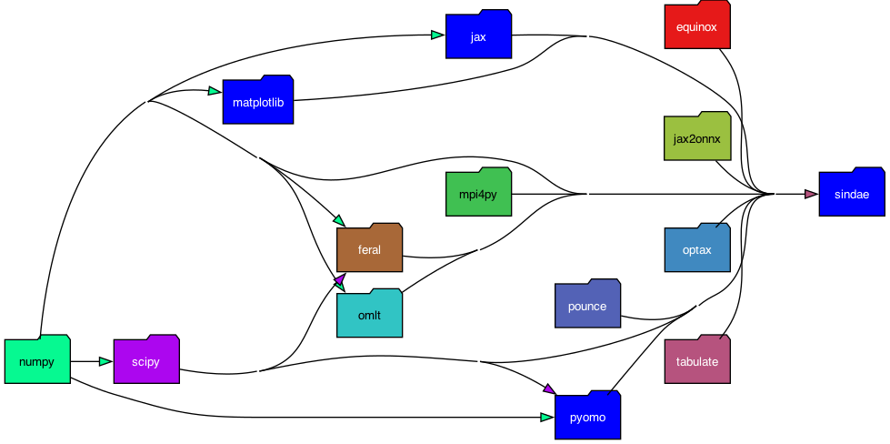

# Summary

## Problem Statement

When modeling dynamical systems, first-principles mechanistic, or constitutive equations are often incomplete or insufficient to capture the true underlying complexity of the phenomena at play. Depending on the system, the modeling shortfall could manifest itself as a reaction rate, growth term, or transfer coefficients for example, which could depend on measured state variables or inputs via a relationship which is not explicitly modeled. While domain experts may recognize portions of the missing dynamics, formulating and validating new governing equations may be slow, or even intractable. Hybrid modeling resolves these dilemmas by leveraging existing mechanistic knowledge while selectively embedding data-driven surrogates to improve fitting and generalization performance. In this way, hybrid models have a two-fold advantage over data-driven or purely-mechanistic approaches. Unlike data-driven models, hybrid models can enforce physical invariants such as mass, energy, or momentum balances into solution routines, allowing mappings learned from data to remain physically consistent. Simultaneously, unlike purely-mechanistic models, hybrid models are able to use valuable experimental data to inform and improve the predictive capability of dynamical systems. The mechanistic vs. data-driven trade off can be tuned to achieve the best performance based on modeling goals, whether that be simulation, model-based-design of experiments (MBDoE), embedded surrogate optimization or other decision-making tasks in the context of engineering. [@mahanty2023hybrid; @MacchiettoMBDoE2008].

While the predictive and extrapolative benefits of hybrid modeling are well-documented across decades of literature [@psichogios1992hybrid;@thompson1994modeling;@herreraruiz2025hybrid;@Narayanan2022Hybrid], existing open-source software \begingroup\color{ForestGreen}usually train the so-called hybrid models via the *sequential* approach, in which the model is simulated (i.e., integrated forward in time and/or space coordinates) at every step before the neural network parameters are updated by first-order optimization methods such as gradient descent.\endgroup{} Furthermore, application target Ordinary Differential Equation (ODE) systems almost exclusively, with a few exceptions [@drgona2023dadaist] which \begingroup\color{ForestGreen}also\endgroup{} solve the training problem using sequential integration. Comparatively little tooling addresses hybrid Differential-Algebraic Equation (DAE) systems, where algebraic constraints must hold alongside differential dynamics. SiNDAE fills this software gap by \begingroup\color{ForestGreen}training hybrid models, including\endgroup{} DAE systems, \begingroup\color{ForestGreen}with\endgroup{} the simultaneous approach for dynamic optimization problems [@Biegler2007]\begingroup\color{ForestGreen}: the model equations are discretized in time, and the state trajectories and network parameters are computed together as the solution of a single nonlinear program (NLP). This approach is faster than sequential training for small- to moderate-size problems and provides a natural framework for hybrid DAEs, and a decomposition variant extends it to large data sets [@Lueg2026Simultaneous].\endgroup{}

## Background

In the field of process systems modeling in science and engineering, paradigms combining data-driven components with purely mechanistic models have gained traction as promising hybrid improvements on traditional methods. The milestone approaches published in this area of research include: Physics Informed Neural Networks (PINNs) [@Raissi2019PINNs], Neural Ordinary Differential Equations (NeurODEs) [@chen2018neural], and Universal Differential Equations (UDEs) [@rackauckas2021universal]. Said hybrid methods have been applied to \begingroup\color{ForestGreen}ODE systems\endgroup{} in domains ranging from bioprocesses [@Bangi2022PINNs;@Narayanan2022Hybrid] to power systems [@Xiao2023PowerSystems] to wastewater treatment [@Huang2025Wastewater]. However, mature scientific machine learning frameworks such as torchdiffeq [@chen2018neural], DiffEqFlux.jl [@rackauckas2019diffeqflux], and diffrax [@kidger2022neuralde] rely on \begingroup\color{ForestGreen}sequential\endgroup{} integrate-and-backpropagate mechanisms designed for ODEs.

Recently, work extending hybridization to Differential Algebraic Systems of Equations (DAEs), so that explicit algebraic constraints are obeyed, has relied on sequential training or penalty loss functions. These methods use techniques such as integration and adjoint sensitivities [@kim2021stiff], stabilization or projection onto the constraint manifold [@white2023stabilized], operator splitting between the differential and algebraic subsystems [@koch2024operator], or penalty terms on the constraint residual [@moya2022daepinn]. Consequently, algebraic constraints are enforced only softly or approximately. Stabilization methods keep physical invariants only approximately satisfied during simulation [@white2023stabilized], and penalty formulations enforce the DAE \begingroup\color{ForestGreen}only as soft constraints,\endgroup{} whose accuracy depends on hyperparameters that, chosen poorly, leave the training of hybrid models ill-conditioned or slow to converge [@moya2022daepinn]. Furthermore, most existing DAE-focused PINN research aims to learn trajectory solutions of fully specified systems [@moya2022daepinn], rather than discovering unknown functional components within constrained systems.

To overcome these issues, Lueg et al. propose two novel training strategies\begingroup\color{ForestGreen}, the simultaneous and the decomposition approaches,\endgroup{} to tackle rigorous DAE constraint enforcement, addressing higher-index hybrid DAE systems, and scale to many trajectories [@Lueg2026Simultaneous]. The simultaneous approach employs a strategy similar to simultaneous approaches for \begingroup\color{ForestGreen}the dynamic optimization of\endgroup{} purely-mechanistic DAEs by discretizing the domain using direct transcription methods such as orthogonal collocation, \begingroup\color{ForestGreen}so that the network parameters and the discretized states and algebraic variables of all trajectories become the decision variables of a single NLP, which is then solved\endgroup{} using a capable nonlinear solver such as IPOPT [@wachter2006ipopt]. Said method effectively achieves constraint enforcement and higher-index system solutions\begingroup\color{ForestGreen}{} because no simulation is performed during training: algebraic equations of any index are ordinary NLP constraints, satisfied at every collocation point at the solution. However, since the network parameters couple all trajectories, the NLP grows with the number of parameters and the amount of training data, which limits the method to\endgroup{} moderately sized systems. \begingroup\color{ForestGreen}To address this limitation\endgroup{}, the decomposition approach adapts training to a bi-level optimization problem, where neural network weights are updated via a sensitivity-based stochastic gradient descent outer loop\begingroup\color{ForestGreen}{} (Adam), with the sensitivities of the subproblem solutions obtained by implicit differentiation of their optimality (KKT) conditions\endgroup{}, while interior iterations solve subproblems parallelized across trajectories with the neural network parameters frozen. Although the decomposition approach \begingroup\color{ForestGreen}alternates between solving the subproblems and updating the weights\endgroup{}, it retains rigorous constraint enforcement \begingroup\color{ForestGreen}of the mechanistic equations, since each subproblem remains a fully discretized NLP (only the network equation is relaxed with penalized slack variables during training),\endgroup{} and higher-index performance while scaling to large numbers of trajectories.

## SiNDAE

SiNDAE implements the simultaneous and decomposition approaches from *A Simultaneous Approach for Training Neural DAEs* by Lueg et al. [@Lueg2026Simultaneous], bridging the tooling and functionality gap by allowing components of DAEs to be learned subject to algebraic constraints efficiently. The package leverages Pyomo and Pyomo DAE to build the underlying nonlinear \begingroup\color{ForestGreen}programs\endgroup{} (NLPs) solved in both approaches, ensuring both rigorous constraint enforcement and sufficient modeling flexibility for diverse applications. SiNDAE's API design is intended to be user-friendly, mirroring widespread machine learning packages' architecture, namely scikit-learn's [@scikit-learn] and SparkML [@SparkMLlib] estimator oriented design. Similarly, its installation is intended to be hassle-free by alleviating the need for external binaries for the linear and nonlinear solvers required, thus streamlining adoption. Interoperability into complementary machine learning, modeling, and optimization ecosystems is facilitated through SiNDAE's export formats, enabling the dissemination of accurate hybrid models for use in downstream use-cases. Together, SiNDAE's functionality and design is intended to facilitate the training of hybrid DAE systems in a user-friendly format, with auxiliary integrations kept in mind.

# Statement of need

## Audience & Scientific Gap:

SiNDAE addresses a critical gap in scientific machine learning by providing a dedicated framework for modeling and training hybrid Differential-Algebraic Equation (DAE) systems effectively using the simultaneous approach [@Biegler2007]. The package targets researchers and practitioners in science and engineering in general, \begingroup\color{ForestGreen}including applied physicists\endgroup{} who hold mechanistic DAE models with uncharacterized or uncertain terms (e.g., complex reaction kinetics or mass transfer coefficients) and possess noisy, incomplete state measurements. While existing hybrid differential equation packages \begingroup\color{ForestGreen}train models sequentially and\endgroup{} focus almost exclusively in Ordinary Differential Equations (ODEs), SiNDAE \begingroup\color{ForestGreen}trains them simultaneously, allowing\endgroup{} users to learn unknown functional components directly within index-1 and higher-index DAE systems. By enforcing governing algebraic equations as hard constraints \begingroup\color{ForestGreen}at every discretization point\endgroup{} during both training and inference, SiNDAE ensures that unobserved state variables remain physically consistent, enabling robust extrapolation to unmeasured operating regimes, a defining advantage of hybrid modeling [@vonstosch2014hybrid; @herreraruiz2025hybrid].

## Usability & Open Access

A major barrier to the adoption and open reproduction of hybrid modeling workflows is the lack of open-source software and the reliance on proprietary or complex solver installation stacks [@mahanty2023hybrid]. Traditional dynamic optimization workflows often depend on solvers like IPOPT [@wachter2006ipopt], paired with efficient sparse linear solvers (e.g., HSL's MA27) that require specialized licenses and compiled binaries, hindering code sharing across communal repositories. SiNDAE overcomes this hurdle by featuring a completely license-binary-free default installation powered by the POUNCE [@kitchin2026pounce] interior-point solver and the FERAL [@kitchin2026feral] linear solver, both distributed directly via standard Python wheels. Practitioners can execute the entire pipeline out of the box, spanning parameter pre-training and simultaneous/decomposition training to model inference, while retaining optional support for traditional cyipopt backends. Furthermore, SiNDAE adopts an estimator-oriented API architecture modeled after scikit-learn (HybridDAE and ProblemDefinition), reducing the learning curve for ML practitioners. Trained models can be exported to Equinox, ONNX, JSON, or OMLT NetworkDefinition objects [@ceccon2022omlt], allowing identified surrogates to be embedded seamlessly into downstream optimization and control workflows. Additionally, to enable expedited hybrid modeling workflows using modern AI coding agents (primarily Claude Code), a directory called `sindae-skills` containing an instruction file and several skill files has been included. When configured for a coding agent working on a SiNDAE project, the instruction file guides the user interaction and modeling process through latex equation rendering and transparency rules, while skill files provide design decision and implementation best practices.

## Ecosystem & Dependencies

SiNDAE is built upon established scientific Python infrastructure. Symbolic model construction and Lagrange–Radau collocation on finite elements are managed via Pyomo and Pyomo.DAE [@bynum2021pyomo;@nicholson2018pyomodae], while Pyomo's PyNumero interface exposes the underlying NLP structures and KKT systems for implicit differentiation. Neural network architectures, exact higher-order automatic differentiation, and outer-loop optimization updates are powered by JAX [@jax2018github], Equinox [@kidger2021equinox], and Optax [@deepmind2020jax]. Fundamental data manipulation, scientific routines, and visualization are supported by NumPy, SciPy, and Matplotlib. Parallelization of the decomposition strategy is enabled through the optional use of MPI for Python [@dalcin2005mpi]. Exporting and printing functionality are handled by the jax2onnx [@jax2onnx] and tabulate [@tabulate] packages respectively. \autoref{fig:fig1} illustrates the resulting dependency architecture.

\begingroup\color{ForestGreen}

# State of the field

Existing open-source packages and proposed approaches for hybrid modeling with neural differential equations, such as torchdiffeq [@chen2018neural], DiffEqFlux.jl [@rackauckas2019diffeqflux], and diffrax [@kidger2022neuralde], have their models trained using ODE integrators, while the DAE-focused approaches in the literature either still use integrator-based training and/or rely on penalty terms added to the loss functions during training [@kim2021stiff, @white2023stabilized, @koch2024operator, @moya2022daepinn, @drgona2023dadaist]. On the other hand, tools that implement the simultaneous approach, such as Pyomo.DAE [@nicholson2018pyomodae], were originally intended for purely mechanistic/pysics-based models. Furthermore, well-known packages such as the Optimization and Machine Learning Toolkit (OMLT) [@ceccon2022omlt] are focused in embedding already trained neural networks into Pyomo models for optimization and decision-making purposes, but it does not focus on the trainign step. Since the simultaneous approach replaces an integrator with a discretized NLP that is solved employing an interior-point method, it is a different approach compared to the integrate-and-backpropagate architecture of the previous existing packages. Therefore, SiNDAE was conceptualized and built on top of the Pyomo [@bynum2021pyomo] ecosystem, facilitating both the training of embedded neural networks to the discretization capabilities of Pyomo.DAE and the modeling of physics-based equations.

# Software design

The main design decision in SiNDAE is to function on top of an algebraic modeling language that is free and open-source, i.e. the Pyomo ecosystem [@bynum2021pyomo], augmenting a stable and robust programming package with hybrid modeling capabilities in the context of scientific machine learning.  Furthermore, this design decision allows SiNDAE to be a package that facilitates not only the training step of the neural DAEs, but also the joint representation of both physics-based and machine-learning based expressions, due to the Pyomo modeling paradigm. Regarding the training step, SiNDAE offers two approaches that share the same problem definition and can be switched with a single keyword argument. First, the simultaneous approach solves the training problem as a single, monolithic constrained NLP, while providing the interior-point solver with exact second derivatives. For small to medium-sized hybrid models with few neural components and not many trajectories, this approach converges adequately in feasible computational time. However, as more training trajectories are available and deeper neural networks may be needed, this approach rapidly becomes challenging from a computational time persepctvie, since the of the underlying NLP grows with the number of network parameters and trajectories quickly. 

Therefore, based on our published recent work [@Lueg2026Simultaneous] we also provide a second training method, called the decomposition-based approach. It replaces a single large NLP with smaller per-trajectory ones that can be solved in parallel with parallel computing, i.e., Message Passing Interface  (MPI) [@dalcin2005mpi] in Python, at the cost of an outer gradient-based loop. Users of SiNDAE can easily switch between both training methods with a single keyword argument definition without modifying their model instance.

Regarding the neural network embedment in the large-scale optimization training problem, software design decisions were also made. We observed trade-off relationships realted to how the neural network is embedded in the training problem itself. By default, the neural networks can be written as explicit Pyomo expressions, exposing exact second derivatives to the solver, while the Pyomo grey-box interface option evaluates the network in modern ML packages (i.e., JAX) providing only first derivatives, while employing a quasi-Newton approximation of the Hessian. This can be slower per iteration but scales adequately to deeper neural networks. Moreover, since NLP solvers require robust initial estimates, the `fit()` pipeline first smooths the measured data and pre-trains the neural components on the smoothed trajectories, and uses these results to initialize training. All of these software design decisions are implemented in a way that a practitioner does not have to intervene, but advanced users have easy access to these steps.

Lastly, SiNDAE's software stack separates the mechanistic model representations from the neural network ones. Models are written in Pyomo, so that the equations are expressed as in conventional dynamic optimization approaches, while JAX handles the neural networks and their derivatives. PyNumero [@rodriguez2023pynumero] bridges both by exposing the NLP and Karush-Kunh-Tucker (KKT) matrices needed by the decomposition-based approach. POUNCE and FERAL are used as the default solvers so that the full pipeline installs from Python wheels without requiring any extra steps. IPOPT and HSL (formerly the Harwell Subroutine Library) solvers available as optional dependencies if the user has an HSL license.

\endgroup{}

# Vignette

To illustrate `SiNDAE`'s core capabilities and user workflow, consider a classic process engineering system: a two-tank liquid cascade operating as an index-1 Differential-Algebraic Equation (DAE), shown in \autoref{fig:fig2}a. In this system, liquid levels $h_1(t)$ and $h_2(t)$ evolve under a constant feed rate $F_{in}$ and inter-tank flows $q_1(t)$ and $q_2(t)$:

$$
\begin{aligned}
A_1 \frac{dh_1}{dt} = F_{in} - q_1, \qquad A_2 \frac{dh_2}{dt} = q_1 - q_2, \qquad q_2 = c_2\sqrt{h_2}
\end{aligned}
$$

In practical scenarios, physical relationships are often only partially known. Here, the outlet relation of the second tank ($q_2$) is explicitly governed by a known valve equation, while the inter-tank discharge law ($q_1$) is unknown and must be learned from noisy, sparse trajectory data of the liquid levels.

The core philosophy of `SiNDAE` is to eliminate the mathematical and software engineering overhead traditional in dynamic optimization. Rather than requiring users to manually formulate orthogonal collocation matrices, derive sensitivity relations, or manage complex C++/Fortran solver dependencies, `SiNDAE` encapsulates the entire hybrid training and inference pipeline into a high-level, estimator-oriented architecture.

\begingroup\color{ForestGreen}To train this hybrid model with\endgroup{} `SiNDAE`, a user only needs to perform three concise steps:

1. **Define the Physics:** Subclass `ProblemDefinition` to specify the mechanistic DAE in `Pyomo` format and designate which variables enter and exit the neural surrogate (\autoref{fig:fig2}b).
2. **Configure and Fit:** Assemble the multi-stage training pipeline by pairing the problem with stage configuration objects. Calling `fit()` automatically handles data smoothing, supervised network pre-training, and \begingroup\color{ForestGreen}training with the simultaneous approach\endgroup{} (\autoref{fig:fig2}c). Users can seamlessly swap between the simultaneous and decomposition algorithms or customize neural architectures via `SiNDAE`'s grey-box interface.
3. **Predict and Export:** Call `predict()` on the fitted estimator to evaluate new initial conditions or operating regimes (\autoref{fig:fig2}c). Because `predict()` \begingroup\color{ForestGreen}solves the discretized hybrid DAE with the trained network fixed\endgroup{}, all predicted trajectories satisfy hard algebraic constraints \begingroup\color{ForestGreen}at every collocation point\endgroup{}.

As shown in \autoref{fig:fig2}d, although the neural network $f_{NN}(h_1, h_2; \theta)$ receives no prior structural information, its learned response collapses onto the true physics ($c_1\sqrt{h_1}$). Furthermore, predictions under unseen initial charges track reference trajectories (\autoref{fig:fig2}e). Once identified, the trained hybrid model can be directly exported to ONNX, Equinox, or `OMLT` formats for use in downstream surrogate optimization and control tasks.

\begingroup\color{ForestGreen}

# Research impact statement

SiNDAE implements in a straightforward interface, the training methods introduced in our recent work by Lueg et al. [@Lueg2026Simultaneous], published in *Computational Optimization and Applications*. SiNDAE started from the research code used in that work. The package is released on PyPI, tested through continuous integration, and documented with worked examples that include the case-studies from our published work previously mentioned.

SiNDAE has also been used in ongoing research presented at conferences and is being used in internal funded project by our research teams. Presentations include the decomposition approach for scalable training of hybrid models [@Lueg2026AIChEDecomposition] and a multiscale hybrid model for predicting monoclonal antibody glycosylation in mammalian cell cultures [@Alves2026AIChEGlycosylation], both presented at the 2026 AIChE Annual Meeting.

\endgroup{}

# Availability

``SiNDAE`` is available on [PyPI](https://pypi.org/project/sindae/) and has its source code hosted on [\begingroup\color{ForestGreen}GitHub\endgroup{}](https://github.com/Alves-research-group/SiNDAE). The documentation contains
thorough [descriptions of the API and functionality](https://alves-research-group.github.io/SiNDAE/index-1/), as well as [theoretical](https://alves-research-group.github.io/SiNDAE/hybrid-dae-overview/) grounding for both the [simultaneous](https://alves-research-group.github.io/SiNDAE/simultaneous-solver/) and the [decomposition](https://alves-research-group.github.io/SiNDAE/decomposition-solver/) methods available, [instructions](https://alves-research-group.github.io/SiNDAE/hybrid-dae/) on how to configure a hybrid DAE system, as well as a [gallery of examples](https://alves-research-group.github.io/SiNDAE/index-2/).

The authors aim to supply both proper documentation to the users in the open-source software community and provide sufficient grounding in theory to enable them to design, implement, and distribute hybrid DAE models for their use-case.

# AI Usage Disclosure

AI Coding assistants, primarily Claude Code, were used during the development of `SiNDAE`. Their role was confined to restructuring the original research code of [@Lueg2026Simultaneous] into an installable package, migrating the solver backends, writing tests, configuring documentation, and debugging. The numerical methods, the problem formulations, and the validation criteria are the authors' own. \begingroup\color{ForestGreen}Claude was also used to help review the grammar, wording, and terminology of this manuscript and to suggest its restructuring to follow JOSS required guidelines and sections. All AI-assisted text was reviewed and revised by the authors. AI-assisted code was verified by the authors and through the package's automated test suite.\endgroup{}

\begingroup\color{ForestGreen}

# Acknowledgements

The authors gratefully acknowledge the support from the [Center for Advanced Process Decision-making (CAPD)](https://capd.cheme.cmu.edu) in the Department of Chemical Engineering at Carnegie Mellon University

\endgroup{}

# References
